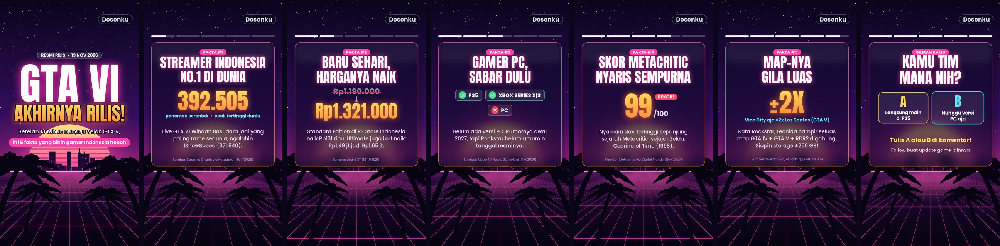
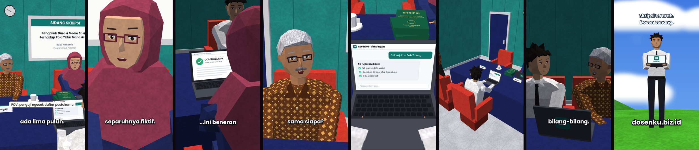

# kontener

Kumpulan gaya (style) video konten pendek untuk marketing **Dosenku**.
Tiap style adalah template: isi teksnya ditulis di satu file JSON, lalu satu perintah
menghasilkan video MP4 vertikal (1080×1920, 30 fps) lengkap dengan musik dan watermark.

## Daftar style

| Kode | Nama | Cocok untuk | Contoh |
|---|---|---|---|
| `style-01` | [Synthwave Fakta](styles/style-01-synthwave-fakta/) | Listicle "N fakta" seputar topik yang lagi ramai (game, gadget, tren), ditutup polling A/B di komentar | [`konten/gta-vi.json`](konten/gta-vi.json) |
| `style-02` | [PS2 Cutscene Skit](styles/style-02-ps2-cutscene/) | Skit komedi 3D low-poly ala cutscene PS2 dengan subtitle, punchline soal produk, end card URL | [`konten/sidang-skripsi.json`](konten/sidang-skripsi.json) |





## Setup (sekali saja)

1. Install **Python 3.10+** dan **ffmpeg**. Di Windows:
   ```powershell
   winget install Python.Python.3.12
   winget install Gyan.FFmpeg
   ```
   Tutup lalu buka lagi terminal setelah install.
2. Di folder repo ini:
   ```powershell
   python -m venv .venv
   .venv\Scripts\activate
   pip install -r requirements.txt
   ```

## Bikin video baru

1. Salin contoh dari style yang mau dipakai, mis. `copy konten\_template.json konten\topik-baru.json`
   (style-01) atau `copy konten\sidang-skripsi.json konten\skit-baru.json` (style-02).
2. Edit isinya. Panduan tiap field ada di README style-nya.
3. Cek tampilan dulu (cepat, hanya gambar):
   ```powershell
   python build.py konten\topik-baru.json --preview
   ```
   Hasilnya di `output\topik-baru-preview\`. Pastikan tidak ada teks yang terlalu panjang.
4. Render videonya:
   ```powershell
   python build.py konten\topik-baru.json
   ```
   Hasilnya `output\topik-baru.mp4`, siap upload ke TikTok, Reels, atau Shorts.

## Struktur folder

```
kontener/
├─ build.py                  # perintah utama: JSON -> MP4
├─ konten/                   # satu file JSON = satu video
│  ├─ _template.json         # template style-01
│  ├─ gta-vi.json            # contoh style-01
│  └─ sidang-skripsi.json    # contoh style-02
├─ styles/
│  ├─ style-01-synthwave-fakta/
│  │  ├─ README.md           # panduan gaya: warna, font, layout, timing, tipe hero
│  │  ├─ style.py            # mesin visual (Renderer)
│  │  ├─ music.py            # musik latar orisinal
│  │  └─ preview.jpg
│  └─ style-02-ps2-cutscene/
│     ├─ README.md           # panduan skit, pose, karakter, audio
│     ├─ style.py            # kamera, subtitle, end card (Renderer)
│     ├─ engine.py           # renderer 3D low-poly (moderngl)
│     ├─ character.py        # karakter ber-rig
│     ├─ sets.py             # ruang sidang, props, bukit
│     ├─ skits/sidang.py     # koreografi skit "Sidang Skripsi"
│     ├─ music.py            # musik lounge + SFX
│     └─ preview.jpg
├─ assets/fonts/             # Anton + Poppins (lisensi OFL)
└─ output/                   # hasil render (tidak masuk git)
```

## Menambah style baru

1. Buat folder `styles/style-03-<nama>/` berisi `style.py` (punya class `Renderer(cfg)` dengan
   `scenes`, `starts`, `total`, `frame(g)`, `cut_times()`, dan konstanta `W`, `H`, `FPS`) serta `music.py`
   (fungsi `make_music(path, total, cuts, cfg=None)`, opsional konstanta `LOUDNESS`). Paling gampang: salin style yang paling mirip lalu ubah.
2. Di file konten, isi `"style": "style-03"`.
3. Tambahkan barisnya di tabel "Daftar style" di atas.

## Catatan

- Semua visual dan musik dibuat dari nol oleh kode. Jangan masukkan logo, karakter, atau cuplikan
  trailer milik pihak lain (mis. Rockstar) supaya aman dari klaim hak cipta.
- Font Anton dan Poppins memakai SIL Open Font License; lisensinya ada di `assets/fonts/`.
