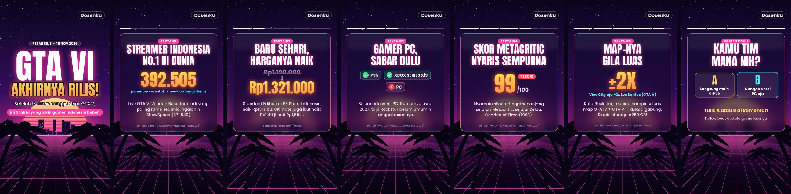

# Style 01 — Synthwave Fakta

Video listicle "N fakta" bernuansa synthwave/Miami: langit ungu, matahari bergaris, skyline,
pohon palem siluet, dan grid neon yang bergerak. Teks ada di kartu kaca (glassmorphism)
dengan progress bar ala Stories di atasnya.



Contoh pertama: `konten/gta-vi.json` (GTA VI, 21 Nov 2026).

## Struktur video

| Scene | Durasi default | Isi |
|---|---|---|
| Hook | 4,5 dtk | Tag kecil, **judul raksasa** (pop-in + flash), kalimat penegas kuning, satu baris konteks, pill pink "ini N fakta…" |
| Fakta ×N | 6,5 dtk/fakta | Pill "FAKTA #n", headline 2 baris, **hero** (angka/harga/chip/skor/teks besar), penjelasan ≤3 baris, sumber |
| Outro | 5 dtk | Headline pertanyaan, 2 kotak pilihan A/B, ajakan komentar, ajakan follow |

Total dengan 5 fakta = 42 detik. Durasi diatur di `"timing"`. Pakai kelipatan 0,5 detik supaya
pergantian scene jatuh pas di ketukan musik (120 BPM). Jumlah fakta bebas; progress bar menyesuaikan.

## Identitas visual

**Warna**

| Peran | Hex |
|---|---|
| Langit atas → bawah | `#09051C` → `#340E5C` → `#962278` |
| Pink utama (pill, glow, grid) | `#FF3EA5` |
| Gradasi angka hero | `#FFD85C` → `#FF923E` |
| Caption hero | `#5AE8FF` |
| Teks isi | `#E2D6FF` |
| Teks sumber | `#B2A0DC` |
| Chip oke / tidak | `#3CDC8C` / `#FF4860` |

**Font**: Anton (headline & angka, huruf kapital), Poppins Bold/Medium/Regular (isi, pill, sumber).

**Layout** (kanvas 1080×1920): watermark pill di kanan atas (y≈150), progress bar y=276,
kartu kaca x 60–1020 / y 330–1300. Area di bawah kartu sengaja hanya dekorasi karena di TikTok
tertutup caption dan tombol.

**Animasi**: elemen masuk bertahap (slide-up + fade, ease-out cubic), angka menghitung naik,
harga lama dicoret lalu harga baru pop (ease-out-back), chip "tidak" bergetar, kartu keluar
dengan fade + naik di 12 frame terakhir, flash putih tipis di awal tiap scene.

**Audio**: synthwave orisinal 120 BPM (Am–F–C–G), kick four-on-the-floor, arp dengan delay,
impact di frame pertama, whoosh + hit di tiap pergantian scene, fade out di akhir.
Loudness dinormalisasi ke −14 LUFS (standar TikTok/Reels/YouTube).

## Field JSON

```jsonc
{
  "style": "style-01",
  "brand": { "watermark": "Dosenku" },          // kosongkan "" kalau tidak mau watermark
  "timing": { "hook": 4.5, "fact": 6.5, "outro": 5.0 },
  "fact_label": "FAKTA",                         // jadi "FAKTA #1", "FAKTA #2", ...
  "hook": { "tag": "...", "title": "...", "headline": "...", "line": "...", "pill": "..." },
  "facts": [ { "head": ["BARIS 1", "BARIS 2"], "hero": { ... }, "body": "...", "source": "..." } ],
  "outro": { "pill": "...", "head": ["...", "..."],
             "options": [ { "letter": "A", "lines": ["...", "..."] }, { "letter": "B", "lines": ["...", "..."] } ],
             "cta": "...", "follow": "..." }
}
```

Tiap fakta boleh punya `"label"` sendiri untuk mengganti teks pill (mis. `"BONUS"`).

### Tipe hero

| `type` | Field | Tampilan |
|---|---|---|
| `counter` | `value` (angka), `caption`, opsional `prefix`/`suffix` | Angka besar menghitung dari 0, format titik ribuan (392.505) |
| `price` | `old`, `new` (teks) | Harga lama dicoret, panah, harga baru pop |
| `chips` | `items: [{text, ok}]` | `ok:true` = chip hijau baris atas, `ok:false` = chip merah baris bawah (bergetar) |
| `score` | `value`, `max`, opsional `badge` | Skor menghitung naik + "/max" + badge merah |
| `big` | `text`, opsional `caption` | Teks besar bebas (±2X, 50%, No.1) dengan pop |

## Batas panjang teks

- Headline fakta: 2 baris; huruf otomatis mengecil kalau baris terlalu lebar, tapi usahakan ≤18 karakter per baris.
- `body`: ±110 karakter (3 baris). Lebih dari itu akan menabrak sumber.
- `source`: 1 baris pendek.
- `hook.title`: 1–8 karakter paling kuat (mis. "GTA VI").
- Selalu cek dengan `--preview` sebelum render penuh.

## Resep konten untuk penonton Indonesia

Angle yang terbukti kuat di video pertama, urutkan dari yang paling memancing:

1. **Kebanggaan lokal**: orang/brand Indonesia yang jadi nomor 1 di topik itu.
2. **Harga dalam rupiah**: harga resmi di Indonesia, naik/turun, perbandingan dengan luar negeri.
3. **Akses & platform**: bisa dimainkan/dipakai di mana, apa yang belum tersedia di Indonesia.
4. **Rekor & angka**: skor, penjualan, penonton, yang bisa dijadikan hero angka.
5. **Skala/kebutuhan praktis**: ukuran, storage, spesifikasi, "siapin ini dulu".

Tutup dengan polling A/B yang membelah penonton (mis. "langsung beli" vs "nunggu"), karena
komentar mendorong distribusi. Selalu cantumkan sumber dan tanggal di tiap fakta.
