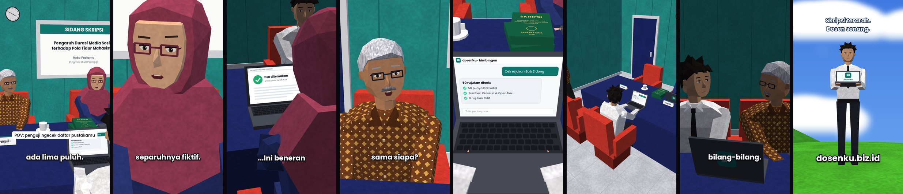

# Style 02 — PS2 Cutscene Skit

Skit komedi pendek bergaya cutscene game PS2: karakter 3D low-poly (faceted, tekstur kain),
ruangan berwarna jenuh, potongan kamera ala sinetron/game, subtitle putih tebal 2–3 kata di bawah,
caption "POV:" di awal, lalu end card produk di bukit hijau dengan langit biru.



Contoh pertama: `konten/sidang-skripsi.json` — skit "Sidang Skripsi" untuk Dosenku (32,5 dtk).

## Cara kerja

```
konten/<nama>.json  ──►  style.py (kamera, subtitle, end card, overlay)
                          ├─ skits/<skit>.py   koreografi: shot kamera, pose, gestur, jalan
                          ├─ character.py      karakter ber-rig (kepala, mata, alis, mulut, lengan, kaki)
                          ├─ sets.py           ruang sidang, props, tekstur (logo, layar, slide), bukit
                          ├─ engine.py         renderer OpenGL (moderngl) + shader kain/batik/kulit
                          └─ music.py          musik lounge orisinal + SFX dari daftar di JSON
```

3D dirender di 720×1280 lalu di-upscale ke 1080×1920 supaya terasa seperti grafis PS2.
Teks (subtitle, POV, URL) digambar di resolusi penuh supaya tetap tajam.

## Yang bisa diubah lewat JSON (tanpa menyentuh kode)

| Key | Isi |
|---|---|
| `lines` | Dialog: `who` (`bu` / `pak` / `mhs`), `text`, `t0`–`t1` (detik). Mulut karakter bergerak di rentang ini, subtitle dipecah otomatis per 2–3 kata. |
| `pov` | Caption kotak putih di awal: `text`, `t0`, `t1`. |
| `endcard` | `url` (mis. `dosenku.biz.id`) dan `tagline` (list baris). |
| `props` | Isi slide proyektor & sampul skripsi: `slide` (2 baris judul), `student`, `prodi`, `year`. |
| `audio.music` | Rentang musik `[[mulai, selesai], ...]`. Jeda di antaranya = hening komedi. |
| `audio.sfx` | Efek suara: `typing`, `ding`, `sting`, `scrape`, `steps`, `jingle` beserta waktunya. |
| `brand.watermark` | Isi teks untuk watermark pojok kanan atas (kosongkan untuk tanpa watermark). |

**Mengganti kata-kata dialog** cukup di JSON. **Menggeser timing jauh** (lebih dari ±0,3 dtk) atau
**membuat cerita baru** perlu menyesuaikan `skits/sidang.py` (atau membuat `skits/<baru>.py`), karena
gestur, arah pandang, dan potongan kamera terikat ke waktu adegan.

## Membuat skit baru

1. Salin `skits/sidang.py` → `skits/<nama>.py`.
2. Atur `SHOTS` (waktu, posisi kamera awal/akhir, target, FOV, set `"room"`/`"hill"`), `CAST`,
   posisi karakter, dan fungsi `states(t)` (pose per waktu: `sit`, `lean`, `head`, `gaze`, `mouth`,
   `blink`, `brow`, `brow_ang`, `eyes_wide`, `smile`, `armL/armR`, `legL/legR`).
3. Buat file konten baru dengan `"skit": "<nama>"` dan `"style": "style-02"`.
4. Cek dengan `python build.py konten/<nama>.json --preview` (1 gambar per shot), baru render penuh.

### Pose cepat

- Lengan: `(pitch, roll, yaw, siku)` dalam derajat. Pitch negatif = ke depan, siku negatif = menekuk ke depan.
  Duduk dengan tangan di meja: `(-58, 8, 18, -32)`.
- Kepala: `(pitch, yaw, roll)`; pitch positif = menunduk. Gunakan `head_aim()` agar karakter menatap titik tertentu.
- Ekspresi: `eyes_wide` (kaget), `brow` (naik/turun), `brow_ang` (+ = marah, − = cemas), `smile`.

## Karakter bawaan

| Kode | Tampilan |
|---|---|
| `student` | Mahasiswa: rambut hitam jabrik, kemeja putih, dasi hitam (gaya sidang) |
| `pak` | Dosen pria: rambut putih, kumis, kacamata, kemeja batik motif kawung |
| `bu` | Dosen wanita: hijab marun, kacamata, blazer navy |

Tambah karakter baru di `SPECS` pada `character.py` (warna kulit, rambut, pakaian, gaya rambut/hijab, kacamata).

## Audio & voice-over

Video keluar dengan musik + SFX di −16 LUFS (lebih pelan dari style-01) supaya ada ruang
untuk suara TTS. Naskah per karakter = isi `lines` di JSON; masukkan audio TTS di detik `t0` tiap baris.

## Kebutuhan

`moderngl` (ada di `requirements.txt`). Di Windows/macOS memakai OpenGL bawaan driver GPU;
di Linux tanpa GPU memakai EGL (Mesa llvmpipe). Render 32 detik ±2 menit dengan 2 proses.

## Batasan hak cipta

Semua model, tekstur, dan musik dibuat dari nol oleh kode. Jangan memasukkan karakter, logo,
atau aset milik pihak lain; gaya "PS2" ditiru lewat teknik (low-poly, upscale), bukan aset game.
