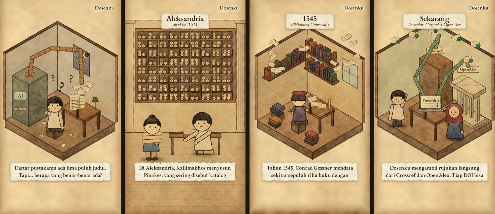

# Style 03 — Parchment Explainer

Video penjelas sejarah bergaya buku cerita. Ilustrasinya tinta dan cat air di atas perkamen tua, dengan
diorama ruang potongan isometrik dan tokoh kepala bulat berponi. Kameranya pelan (Ken Burns) dengan
potongan close-up. Setiap scene muncul dalam dua tahap: garis tinta dulu, lalu catnya "mekar". Label
judul dan subtitle ditulis di sobekan kertas. Semua gambar dan musik dibuat oleh kode.



Contoh pertama: `konten/sejarah-rujukan.json`, sejarah daftar pustaka dari Aleksandria sampai Dosenku
(71,5 dtk, 10 scene).

## Struktur video (contoh)

| # | Scene (`draw`) | Durasi | Isi |
|---|---|---|---|
| 1 | `hook` | 7 | Mahasiswa bingung, mesin "AI" memuntahkan rujukan lewat pipa |
| 2 | `gulungan` | 5 | Perkamen kosong + satu benda (gulungan berlabel ΠΙΝΑΚΕΣ) |
| 3 | `aleksandria` | 7,5 | Rak gulungan Perpustakaan Aleksandria, Kallimakhos menulis |
| 4 | `gessner` | 8 | Ruang kerja 1545, potongan kertas beterbangan |
| 5 | `katalog` | 6,5 | Lemari laci kartu katalog abad ke-19 |
| 6 | `kampus` | 7 | Antre bimbingan di depan Ruang Dosen |
| 7 | `doi` | 7,5 | Buku besar, setiap entri bertag DOI, terhubung ke globe |
| 8 | `ai` | 8,5 | Mesin chatbot mencetak rujukan, kertas "hantu" bertanda tanya |
| 9 | `dosenku` | 8 | Laptop Dosenku tersambung pipa ke Crossref & OpenAlex, kartu bercentang |
| 10 | `penutup` | 6,5 | Buku terbuka teal, "Dosenku", tagline, pita URL |

Pola ceritanya: **hook masalah → mundur ke sejarah → masalah yang sama di zaman sekarang → produk
sebagai jawaban → end card**. Pola ini bisa dipakai untuk topik lain (sejarah sidang, sejarah plagiarisme, dll.).

## Identitas visual

| Peran | Nilai |
|---|---|
| Kertas | `#EAD6AA` dengan noda, serat, dan tepi terbakar |
| Tinta | `#281C15`, garis sedikit bergoyang dan menipis di ujung |
| Kayu / dinding | `#966840` / `#DEC8A0` |
| Aksen produk | teal `#0F766E` (cap centang, pita URL, garis watermark) |
| Grading | warm (R 1,0 / G 0,965 / B 0,9) + arsiran etsa otomatis di area gelap |

**Font**: Cardo (label judul, tulisan di ilustrasi), Crimson Text SemiBold (subtitle). Keduanya OFL dan
ada di `assets/fonts/`.

**Layout** (1080×1920): watermark "Dosenku" di kanan atas (y≈74), label judul di tengah atas (y≈190),
subtitle di y≈1540. Isi utama ilustrasi di kanvas logis y 330–1690.

## Field konten JSON

```json
{
  "style": "style-03",
  "story": "sejarah-rujukan",
  "scenes": [
    {"draw": "aleksandria", "dur": 7.5, "label": "Aleksandria", "sub": "abad ke-3 SM",
     "shots": [[620, 1150, 1.04, 1.1], [700, 1330, 1.55, 1.65]], "cuts": [0.5]}
  ],
  "voiceover": [{"t0": 12.4, "text": "teks subtitle", "tts": "ejaan untuk TTS", "max": 5.8}],
  "voices": {"narator": "<ID Fish Audio>"}, "voice_speed": {"narator": 1.05}
}
```

- `story`: file di `stories/`, berisi fungsi gambar per adegan dan dict `SCENES`.
- `draw`: nama adegan di `SCENES`. `dur` dalam detik.
- `label` / `sub` (opsional): label sobekan kertas di atas.
- `shots`: `[cx, cy, zoom_awal, zoom_akhir]` atau `[cx0, cy0, z0, cx1, cy1, z1]`, dalam koordinat kanvas
  logis 1240×2204. Zoom 1 = seluruh kanvas, dan zoom maksimal sekitar 1,7 supaya tetap tajam.
  `cuts` = titik potong antar-shot (pecahan durasi). Tanpa `cuts`, durasi dibagi rata.
- `captions: false` / `watermark: false` per scene (mis. end card).
- `voiceover[].text` = subtitle, `tts` = teks yang dibacakan (angka & singkatan dieja). Subtitle dipecah
  per 2 baris dan waktunya diperkirakan dari `caption_cps` (karakter/detik, default 14,5).

## Menggambar adegan baru

Buat `stories/<cerita>.py`. Setiap adegan berupa fungsi `def nama(c): ...` yang menggambar di `ink.Canvas`
(koordinat logis), lalu daftarkan di `SCENES = dict(nama=nama, ...)`. Bahan yang tersedia:

- `ink.py`: `c.shape(poly, warna, outline=, hatch=)` (bersihkan → cat air → arsir → garis tinta),
  `c.line`, `c.text`, `c.wash`, `Iso` (proyeksi isometrik), `iso_box`, `person(...)` (pose `stand`/`sit`/`walk`/`kneel`,
  rambut `bowl`/`bun`/`hijab`/`old`/`cap`, lengan `down`/`up`/`forward`/`point`/`(dx, dy)`, `hold=` untuk benda di
  tangan), `book`, `shelf_books`, `paper_slip`.
- `props.py`: `room` (diorama potongan), `window`, `wall_shelf`, `pipe`, `magnifier`, `draft_stack`,
  `check_stamp`, `ghost_slip`, `laptop_front`, `column`, `scissors`.

Gambar dari belakang ke depan, karena setiap `shape` menutup apa pun di belakangnya. Cek dulu dengan
`python build.py konten\x.json --preview`. Preview mengambil frame di 62% durasi scene, jadi yang terlihat
biasanya shot close-up.

## Audio

`music.py`: folk orisinal 84 BPM (gitar petik sintetis, bass, pad, glockenspiel) dengan progresi D–A–Bm–G.
Ada efek balik halaman di setiap pergantian scene dan akor D yang berdering di end card. Targetnya −17 LUFS
supaya narasi dari `voice.py` (Fish Audio) tetap jelas. Musik otomatis mengecil (ducking) saat ada suara.
