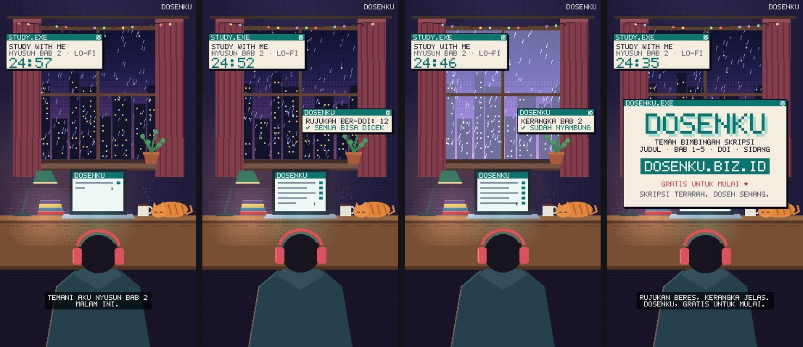

# Style 04: Lo-fi Pixel Study

Loop "study with me" dalam pixel art 270×480 yang diperbesar 4× tanpa penghalusan. Font bitmap 5×7-nya juga dibuat sendiri (`pixel.py`).

Isi adegannya kamar kos di malam hujan:

- Jendela besar: kota dengan jendela-jendela berkedip, hujan, tetes di kaca, petir.
- Lampu tumblr di atas jendela, gorden, dan tanaman.
- Meja: lampu meja, buku, kopi beruap, dan kucing tidur yang ekornya sesekali bergerak.
- Mahasiswa berheadphone dilihat dari belakang, kepalanya mengangguk mengikuti ketukan.
- Laptop yang menampilkan aplikasi Dosenku.

Overlay-nya berupa jendela retro:

- Panel judul dengan timer pomodoro.
- Notifikasi yang muncul bergantian.
- Caption narasi.
- Panel CTA di akhir.

Contoh: `konten/lofi-bab2.json` (30 dtk).

## Field JSON

| Field | Isi |
|---|---|
| `duration`, `bpm` | Panjang video dan tempo (anggukan kepala ikut tempo) |
| `title` | `{bar, line1, line2, timer}` (timer dalam detik, menghitung mundur) |
| `notifs[]` | `{t0, t1, y, lines[]}`. Baris yang memakai "✓" berwarna teal |
| `captions[]` | `{t0, t1, lines[]}` untuk narasi |
| `cta` | `{t0, bar, big, line1, line2, url, note, tag}` |
| `lightning[]` | Detik terjadinya petir (guntur menyusul di audio) |
| `screen_rows` | Baris di layar laptop |

Font 5×7 hanya punya huruf kapital, angka, dan tanda baca umum (`. , : ! ? - / ( ) & + % ' ✓ · ♥`).
Teks otomatis dijadikan kapital.

## Audio

Lo-fi hip-hop orisinal 80 BPM dengan swing, Rhodes, dan bass. Ada juga suara hujan, kresek vinyl, guntur,
bunyi notifikasi retro, dan arpeggio saat CTA muncul. Target −17 LUFS.
