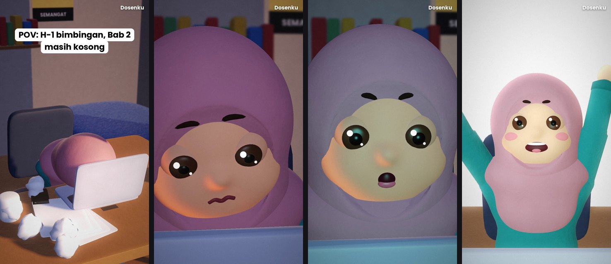

# Style 05: 3D Animasi Sinematik

Film pendek dengan rasa film animasi 3D bioskop. Tokoh dan dunianya **orisinal**: tidak ada karakter, logo, atau aset
studio mana pun. Semuanya dibangun oleh kode.

Contoh: `konten/malam-bimbingan.json`, film pendek "Malam Sebelum Bimbingan" (32,5 dtk, tanpa dialog).
Nara stres karena Bab 2 masih kosong, lalu membuka Dosenku. Paginya dosbing membalas "Bagus. Lanjut Bab 3", dan
video ditutup dengan end card plus narasi singkat.

Contoh kedua: `konten/anthropic-turun.json`, berita pasar "Anthropic turun, semua ikut turun" (66 dtk, @kalpitalbiz).
Tokoh yang sama dengan warna baju lain, kartu data, subtitle kata-per-kata, polling A/B, disclaimer, dan CTA follow.

## Isi folder

| File | Isi |
|---|---|
| `cg.py` | Mesin moderngl. Kulit ber-subsurface, mata mengilap, bayangan lembut, cahaya kunci/isi/rim + cahaya layar, tone-map ACES, quad bertekstur. Bentuk organik dibuat dari SDF yang disatukan halus (`sdf_mesh`) |
| `nara.py` | Tokoh Nara (mahasiswi berhijab) dengan rig sederhana. Mata (iris, pupil, kilau, kelopak yang menutup), alis, mulut (`smile`, `smile0`, `frown`, `wavy`, `flat`, `O`, `A`, `grin_open`), rona pipi, tulang belakang, kepala, lengan |
| `room.py` | Set kamar kos (meja, laptop, HP, lampu, jendela malam→pagi, jam, poster, rak, kasur, lampu tumblr) dan tekstur 2D (layar dokumen kosong, aplikasi Dosenku, notifikasi HP, langit) |
| `stories/<nama>.py` | `malam-bimbingan` (Dosenku) dan `pasar-merah` (berita pasar). Shot kamera (`SHOTS`), pose per waktu (`nara_state`), keadaan dunia (`world_state`), dan cahaya (`light`). Semuanya berupa keyframe halus |
| `style.py` | Renderer: dua lapis (latar diblur sebagai DOF), bloom, vignette, grain, plus overlay hook, end card, dan watermark |
| `music.py` | Skor orkestra kecil: piano, string, pizzicato, glockenspiel. Suasana diatur `music_moods`, efek suara diatur `sfx` |

## Field JSON

| Field | Isi |
|---|---|
| `story` | Nama file cerita di `stories/` |
| `hook` | Teks POV di awal: `{text, t1, y}` |
| `endcard` | `{t0, name, tagline, url, note}` |
| `music_moods` | `[[t, malam/tegang/ajaib/montase/pagi/sorak/krisis/akhir], ...]` |
| `sfx` | `{t, kind}` dengan kind `typing` (`dur`, `fast`), `whoosh`, `buzz`, `ding`, `sparkle`, `pop`, `birds`, `fall`, `thud`, atau `drop` |
| `voiceover` | Narasi `{t0, text, tts, max}`; `"caption": false` = baris itu tidak dijadikan subtitle |
| `watermark` | Teks pojok kanan atas (default `Dosenku`; untuk akun lain mis. `@kalpitalbiz`) |
| `corner_note` | Teks kecil pojok kiri atas yang tampil terus, mis. `Bukan nasihat investasi` |
| `headline` | Banner merah pembuka `{text, t0, t1, y, size}`; `\n` = ganti baris |
| `cards` | Kartu data pop-in `{t0, t1, x, y, label, value, sub, color, size, drop}`; color `red/green/amber/dark/light` |
| `poll` | Polling A/B `{t0, t1, y, question, options: [[A, teks], [B, teks]], note}` |
| `disclaimer` | Kartu kuning `{t0, t1, y, text}` |
| `cta` | Layar penutup ganti end card: `{t0, text, handle, sub}` |
| `sources` | Baris sumber kecil `{t0, t1, y, text}` |
| `captions` | `true` = subtitle kata-per-kata dari `voiceover` (`caption_y`, `caption_cps`) |

## Membuat cerita baru

1. Salin `stories/malam-bimbingan.py`, lalu ubah `SHOTS` (kamera `eye0`→`eye1`, `tgt`, `fov`, `blur`, `hide_front`
   untuk shot lebar dari arah jendela) dan keyframe pose.
2. Pose lengan berupa `(pitch, roll, yaw, tekuk)`. Contohnya ada di `FOLD`, `TYPE`, `REST`, dan `CHEER`.
3. Warna baju bisa diganti per cerita lewat `top_col`, `hijab_col`, `pants_col` di `nara_state`; `sweat: 1` memunculkan
   tetes keringat. Layar laptop/HP/poster bisa diisi tekstur sendiri lewat `world_state` (`screen`, `phone_tex`,
   `posters`), dan `extras(t)` menambah benda 3D (contoh: panah merah jatuh di `pasar-merah.py`).
4. Selalu cek `--preview` dulu. Render penuh 3D 30 fps memakan waktu sekitar 1 detik per frame, jadi kira-kira
   8–12 menit di laptop.
