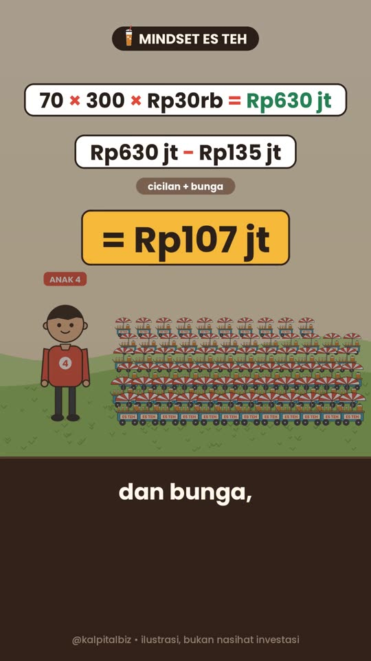

# Style 06 — Kartun Flat (gaya gambar + animasi vektor datar)

Gaya gambar & animasi ala explainer viral "Egg Selling Mindset": langit krem, bukit hijau, tokoh flat, rumus diketik,
angka berhitung naik, stempel istilah, pita subtitle gelap. **Ini gaya visual, bukan template cerita** — jumlah tokoh dan
struktur cerita bebas (lihat contoh). Semua gambar & musik dibuat kode.

| Contoh | Struktur |
|---|---|
| `konten/mindset-es-teh.json` | parabel 4 anak, modal sama → hasil bertingkat |
| `konten/mindset-gaji.json` | 4 karyawan, gaji sama → tabungan 5 tahun |
| `konten/bocor-halus.json` | **1 tokoh** (Rina, berhijab), hitung "bocor halus" → solusi, CTA komen bebas |



## Tokoh
`("person", i, face, arm, True)` = tokoh bernomor 1–4 · `("person", "father", ...)` = kakek ·
`("tokoh", baju_rgb, kulit_idx, rambut, warna_rambut/hijab, badge, face, arm, tongkat, celana_rgb, rok)` = tokoh bebas.
Rambut: `short` / `long` / `hijab` / `old`. Wajah: `smile` / `happy` / `talk` / `o` / `worry`. Lengan: `down` / `up` (melambai).

## Kenapa format ini ditonton sampai habis
1. **Hook 0–4 dtk di layar gelap**: pertanyaan dengan angka (frame pertama sudah berisi judul, bagus untuk thumbnail).
2. **Tangga hasil**: tokoh 1 → 4 hasilnya makin besar, penonton bertahan untuk lihat tokoh terakhir.
3. **Persamaan diketik + angka berhitung naik + kerumunan berlipat**: ada yang berubah tiap ±1 dtk.
4. **Stempel istilah** (TUMBUH ORGANIK, LEVERAGE …): penonton merasa dapat ilmu → save/share.
5. **Pita subtitle gelap di 1/3 bawah**: 2–3 kata, kata yang diucapkan kuning, angka hijau.
6. **Penutup komentar murah**: "Komen 1, 2, 3 atau 4" + follow.

Jangan pakai hook yang menyinggung SARA/stereotip — memang memancing komentar, tapi rawan report & merusak akun.

## Perintah
```powershell
python build.py konten\mindset-es-teh.json --preview
python build.py konten\mindset-es-teh.json
python voice.py konten\mindset-es-teh.json      # narasi (Toren, speed 1.1)
```

## JSON
| key | isi |
|---|---|
| `story` | nama file di `cerita/` (adegan & timing) |
| `series` | label pil di atas, mis. `MINDSET ES TEH` |
| `series_icon` | ikon pil: `teh` / `uang` |
| `footer` | teks kecil paling bawah (akun + disclaimer) |
| `voiceover` | `{t0, text, tts, max}`; subtitle diambil dari `text`, durasi ditaksir dari panjang `tts` ÷ `caption_cps` |

## Menulis cerita baru (`cerita/<nama>.py`)
`build(ctx)` mengembalikan `(elemen, potongan, durasi)`. `ctx["L"](i, frac)` = waktu di dalam kalimat narasi ke-i.
Elemen: `sprite` (tokoh, gerobak, bank, kantor, uang, amplop, tas belanja, HP, laptop, paket, sertifikat, papan …), `pill`, `counter` (× N berhitung),
`eq` (persamaan diketik; `result` muncul hijau), `result` (kotak kuning berhitung), `stamp`, `calendar`,
`crate`, `crowd` (kerumunan berlipat, sprite bebas), `bars` (`cats` = label bawah), `gauge`, `bubble`, `dim`, `title`, `xcheck`, `hooktitle`.
Animasi masuk: `in` = `pop` / `drop` / `stamp` / `fade` / `none`; gerak: `move=[(t, x, y), ...]`.
SFX (pop, ketik, ding, kaching, stempel, whoosh) dibuat otomatis dari timeline.
